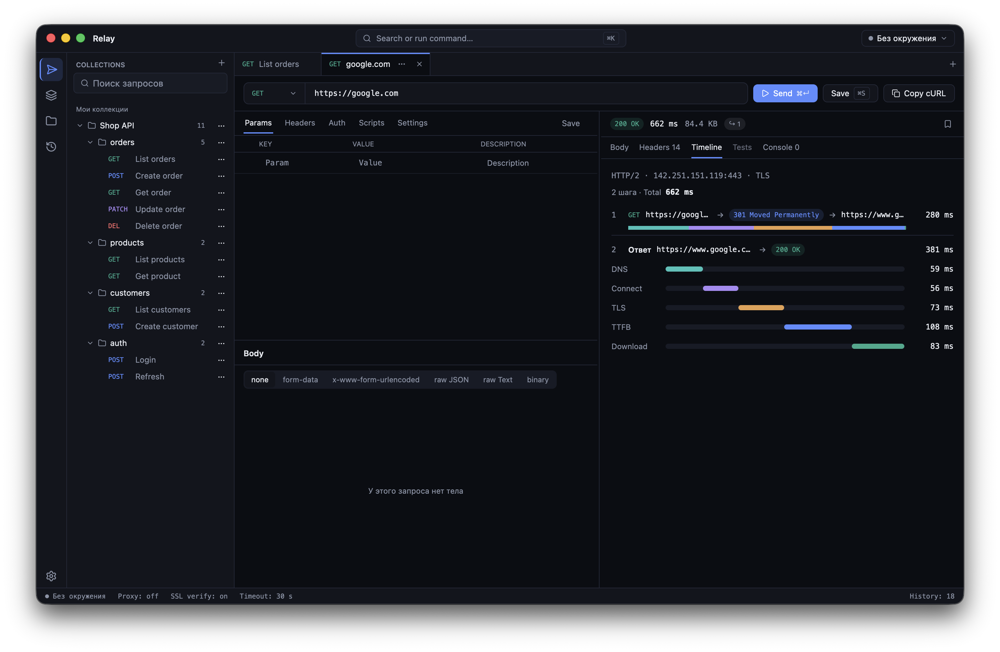

<p align="center">
  
</p>

<h1 align="center">Rivet</h1>

<p align="center">
  Быстрый нативный HTTP‑клиент для API.<br>
  Rust + GPUI · macOS, Windows, Linux · OpenAPI, Postman, скрипты <code>pm.*</code>
</p>

<p align="center">
  
</p>

---

## Почему Rivet

- **Мгновенный.** Нативный интерфейс на GPU (GPUI, движок редактора Zed), без Electron. Большие ответы виртуализированы и не тормозят.
- **Вокруг спецификации.** Импорт OpenAPI 3.x / Swagger 2.0 и Postman‑коллекций, проверка ответа по схеме с переходом к строке расхождения, генерация тела из схемы.
- **Автоматизация.** Pre‑request и Post‑response скрипты с Postman‑совместимым `pm.*` и тестами `pm.test` / `pm.expect` на встроенном JS‑движке [Boa](https://boajs.dev) (чистый Rust).
- **Прозрачный.** Timeline показывает весь путь запроса: каждый редирект (откуда → куда, статус) и фазы DNS / Connect / TLS / TTFB / Download.
- **Всё локально.** Проект хранится у вас: `~/Library/Application Support/Rivet/project.json`, без аккаунтов и облака.

## Быстрый старт

```bash
cargo run --release          # приложение
cargo run --bin gallery      # витрина UI‑компонентов
cargo test                   # все тесты
```

При первом запуске открывается пустой проект. Демо‑спецификацию `examples/shop-api.yaml` можно импортировать через ⌘O.
Если раньше вы пользовались Relay (прежнее название), проект из `Application Support/Relay` переносится автоматически; старый файл остаётся как резервная копия.

## Возможности

### Запросы
- GET / POST / PUT / PATCH / DELETE / HEAD / OPTIONS; Params, Headers, Body (none, form‑data с файлами, x‑www‑form‑urlencoded, raw JSON с подсветкой, Text, binary), Auth (Bearer / Basic / API Key / Inherit from spec).
- Path Variables: сегменты `:id` в URL получают свою таблицу во вкладке Params (как в Postman), значения подставляются при отправке.
- Переменные `{{var}}` из коллекции и активного окружения (коллекция в приоритете) — в URL, params, headers, body и auth, с подсветкой и предупреждением о неопределённых. Встроенные: `{{$uuid}}`, `{{$timestamp}}`, `{{$randomInt}}`.
- cURL: вставьте `curl …` в поле URL — получится запрос; «Copy cURL» копирует активный.
- **Код**: запрос как готовый сниппет — cURL, HTTPie, wget, Python requests, JavaScript fetch, Node.js axios, Go, Rust reqwest, PHP, C#, Java OkHttp, Swift; файлы multipart и бинарного тела остаются ссылками на файлы.
- Вкладка **Docs** — описание запроса (Markdown); у коллекции — своё описание. Описания переносятся в Postman и OpenAPI и из них.
- Вкладки с меню действий, принудительное закрытие, перетаскивание запросов между коллекциями и папками.

### Скрипты
- Вкладка **Scripts**: Pre‑request (меняет запрос и переменные перед отправкой) и Post‑response (разбор ответа, тесты), сниппеты в один клик.
- `pm.environment`, `pm.collectionVariables`, `pm.variables`, `pm.request`, `pm.response`, `pm.test`, `pm.expect` (chai‑подобные проверки), legacy `responseBody` / `tests[...]` / `postman.*`, `console.log`.
- Результаты во вкладках ответа **Tests N/M** и **Console**; ошибка pre‑request скрипта останавливает отправку и показывает строку.
- Скрипты из Postman‑коллекций импортируются вместе с запросами.

```js
// Post-response: сохранить значение для следующих запросов
const json = pm.response.json();
pm.collectionVariables.set("searchId", json.searchId);
pm.test("Status is 200", () => pm.response.to.have.status(200));
```

### HTTP/2 и WebSocket
- HTTP/2 через ALPN (h2 в приоритете), h2c для `http://`, выбор Auto / HTTP/1.1 / HTTP/2 в настройках; HTTP/1.1 и HTTP/2 через CONNECT‑прокси; gzip / deflate / br.
- **WebSocket** (`ws://`, `wss://`): вкладка «+ → WebSocket», Connect / Disconnect, отправка Text / JSON / Binary (hex), ping, шаблоны сообщений, лента входящих и исходящих с подробностями, заголовки и auth рукопожатия. WS‑запросы сохраняются в коллекции и попадают в историю.

### Ответ
- Статус, время, размер; Body: Pretty / Raw / Preview (с поиском ⌘F) / **Browser** (настоящий WebKit с CSS и JS).
- Весь текст во вкладках ответа выделяется мышью и копируется ⌘C.
- Headers, **Timeline** с полным путём редиректов, Tests, Console.
- **Примеры**: закладка в заголовке ответа сохраняет ответ вместе с запросом; примеры видны в сайдбаре под запросом и открываются кликом, экспортируются в Postman и в `responses` OpenAPI.
- Проверка по связанной спецификации: панель расхождений со схемой и переход к строке.

### Коллекции, окружения, история
- Дублировать, копировать, вырезать и вставлять запросы, папки и коллекции (меню «···» в сайдбаре).
- Несколько коллекций, папки, переменные коллекции; обновление коллекции из исходной спецификации; удаление коллекции (исходный файл импорта не изменяется).
- Окружения с цветом, секретами и флагом **Production** — красная рамка и подтверждение перед POST / PUT / PATCH / DELETE.
- История с поиском и повтором запроса.
- Палитра команд ⌘K: нечёткий поиск по запросам, командам и окружениям.

### Интерфейс
- Тёмная и светлая темы, системное меню на macOS и меню в окне на Windows / Linux, иконка в Dock и в `.exe`.

## MCP

Rivet работает как MCP‑сервер: Claude Code, Claude Desktop, Cursor и другие ИИ‑ассистенты могут смотреть коллекции, отправлять запросы, менять переменные и прогонять коллекции. Сервер — тот же бинарник, режим `rivet mcp` (stdio, JSON‑RPC 2.0), окно не открывается. Он работает с тем же `project.json`, что и приложение (или с файлом из `--project <path>`); открытое окно подхватывает изменения сервера автоматически.

Проще всего подключить из приложения: **Настройки → MCP**. Там:
- кнопки «Подключить» для Claude Code (через `claude mcp add --scope user`), Claude Desktop и Cursor — Rivet добавляется в конфиг клиента, остальные серверы не меняются, прежний файл сохраняется как `*.bak`; «Копировать» кладёт в буфер команду или JSON; рядом — статус «подключено / не подключено» и путь к исполняемому файлу;
- переключатели «Разрешить MCP», «Только чтение», «Разрешить отправку запросов», «Показывать секреты ассистенту» — сервер перечитывает их при каждом вызове, перезапуск не нужен;
- «Активность» — последние вызовы ассистентов (время, инструмент, ✓/✗, кратко что сделано, клиент); журнал лежит рядом с `project.json` в `mcp-activity.jsonl` (последние 500 записей), «Очистить журнал» его удаляет.

Вручную, Claude Code:

```bash
claude mcp add rivet -- /Applications/Rivet.app/Contents/MacOS/Rivet mcp
# Windows: claude mcp add rivet -- "C:\Program Files\Rivet\Rivet.exe" mcp
# другой проект: claude mcp add rivet -- /path/to/rivet mcp --project ~/work/api/project.json
```

Claude Desktop (`claude_desktop_config.json`), Cursor (`.cursor/mcp.json`) — так же:

```json
{
  "mcpServers": {
    "rivet": {
      "command": "/Applications/Rivet.app/Contents/MacOS/Rivet",
      "args": ["mcp"]
    }
  }
}
```

| Инструмент | Что делает |
|---|---|
| `list_collections` | коллекции: id, связанный файл спецификации, папки, число запросов |
| `list_requests` | запросы с фильтром по `collection`, `folder`, `query`; `include_spec_endpoints` — операции спецификации проекта |
| `get_request` | полное описание запроса по id, имени или пути `Коллекция / Папка / Имя` |
| `save_request` | создать (`collection`, `folder`, `name`, `method`, `url`, `params`, `headers`, `body`, `auth`, `scripts`) или обновить (`id`) запрос |
| `send_request` | отправить сохранённый (`request_id`) или разовый запрос; `environment`, `follow_redirects`, `timeout_ms`, `max_body_chars`; в ответе статус, заголовки, тело, тайминги, редиректы, тесты, логи скриптов, расхождения со схемой |
| `get_history` | последние отправки (`limit`, `query`) |
| `list_environments`, `set_active_environment`, `create_environment` | окружения: список, выбор активного, создание (цвет, production, переменные) |
| `get_variables`, `set_variable`, `unset_variable` | переменные окружения или коллекции (`scope`: `environment` / `collection`) |
| `import_spec` | импорт OpenAPI / Swagger / Postman / Rivet в новую коллекцию |
| `export_collection` | экспорт коллекции в Rivet (без потерь), Postman v2.1 или OpenAPI 3 — в файл или в ответ (секреты замаскированы) |
| `run_collection` | прогон коллекции или папки по порядку с передачей переменных между запросами; `stop_on_failure`, `environment`, `delay_ms`; отчёт с тестами и итогами |

Как в приложении, `send_request` и `run_collection` выполняют скрипты, сохраняют переменные, выставленные `pm.environment.set` / `pm.collectionVariables.set`, и пишут историю.

Безопасность:
- «Разрешить MCP» выключено — `initialize` и `tools/list` работают, но любой вызов инструмента возвращает ошибку «MCP отключён в настройках Rivet».
- «Только чтение» — `save_request`, `set_variable`, `unset_variable`, `set_active_environment`, `create_environment`, `import_spec` отклоняются; `send_request` и `run_collection` выполняются (если разрешена отправка), но не сохраняют историю и переменные из скриптов (в ответе `persisted: false`).
- «Разрешить отправку запросов» выключено — `send_request` и `run_collection` отклоняются.
- Значения с секретными ключами (`token`, `password`, `secret`, `apikey`, `api_key`, `Authorization`…) в выдаче заменяются на `••••••••`. Аргумент `reveal_secrets: true` учитывается, только если включено «Показывать секреты ассистенту». Маска, отправленная обратно в `save_request`, сохраняет прежнее значение. Тела ответов и логи скриптов не маскируются.
- В окружении с флагом **Production** POST / PUT / PATCH / DELETE (и `run_collection` с такими запросами) отклоняются, пока не передан `confirm_production: true` — ассистент должен спросить вас.
- Каждый вызов читает `project.json` заново и записывает его атомарно; если файл изменился за время вызова, изменения сливаются.

## Обновления

Rivet сам проверяет [GitHub Releases](https://github.com/rivet-soft/rivet/releases): через 5 секунд после запуска и затем каждые 6 часов (выключается в «Настройки → Обновления → Проверять обновления автоматически»; там же «Проверить сейчас» и текущая версия).

- Кнопка обновлений — в левой панели над «Настройками». Синяя точка — доступна новая версия, индикатор загрузки — идёт скачивание, зелёная точка — версия скачана и готова к установке, красная — ошибка.
- По клику открывается окно с номером версии, датой и описанием изменений. «Скачать» загружает архив для вашей системы и сверяет его SHA‑256 с файлом `SHA256SUMS` из релиза; при несовпадении файл удаляется. «Пропустить эту версию» убирает индикатор до следующего релиза, «Открыть страницу релиза» — ссылка на GitHub.
- «Перезапустить и обновить» сохраняет проект, заменяет файлы приложения и запускает новую версию. Старые файлы остаются рядом (`Rivet.app.old-<версия>`, `Rivet.exe.old`, `rivet.old`) и удаляются при следующем запуске.
  - macOS: заменяется весь `Rivet.app`. Автообновление работает, только если Rivet лежит в обычной папке (например, «Программы») — при запуске прямо из образа DMG или из временной копии macOS (App Translocation) сначала перетащите Rivet.app в «Программы».
  - Windows: обновляются `Rivet.exe`, `WebView2Loader.dll` и `examples` в папке, откуда запущен Rivet.
  - Linux: заменяется бинарник `rivet` и файлы рядом с ним из архива.
- Нужны права на запись в папку приложения. Если их нет (например, Rivet установлен в системный каталог), обновитесь вручную: скачайте архив со [страницы последнего релиза](https://github.com/rivet-soft/rivet/releases/latest), проверьте при желании `sha256sum -c SHA256SUMS --ignore-missing` и замените файлы — проект и настройки хранятся отдельно и не пострадают.
- Локальные сборки (версия `…-dev`, запуск из `target/`) не обновляются: кнопка видна, но неактивна.

## Горячие клавиши

| macOS | Windows / Linux | Действие |
|---|---|---|
| ⌘↵ | Ctrl+Enter | Отправить |
| ⌘. | Ctrl+. | Отменить отправку |
| ⌘K / ⌘P | Ctrl+K / Ctrl+P | Палитра команд |
| ⌘T / ⌘W | Ctrl+T / Ctrl+W | Новая / закрыть вкладку |
| ⌥⌘W | Ctrl+Alt+W | Принудительно закрыть вкладку |
| Ctrl+Tab / Ctrl+Shift+Tab | Ctrl+Tab / Ctrl+Shift+Tab | Следующая / предыдущая вкладка |
| ⌘S | Ctrl+S | Сохранить запрос |
| ⌘⇧C | Ctrl+Shift+C | Скопировать как cURL |
| ⌘O | Ctrl+O | Импорт OpenAPI, Swagger или Postman |
| ⌘R | Ctrl+R | Обновить связанные спецификации |
| ⌘E | Ctrl+E | Следующее окружение |
| ⌘1…⌘4 | Ctrl+1…Ctrl+4 | Запросы / Окружения / История / Коллекции |
| ⌘B | Ctrl+B | Показать / скрыть боковую панель |
| ⌘⇧L | Ctrl+Shift+L | Сменить тему |

## Сборка для Windows

Релиз собирается на Windows командой `./scripts/build-windows.ps1` (PowerShell) или вручную через GitHub Actions `Windows build`. Архив появится в `target/windows-release/Rivet-<версия>-windows-x64.zip` (или в артефактах Actions); распакуйте и запустите `Rivet.exe`.

Быстрая проверочная сборка с macOS: `brew install mingw-w64`, затем `./scripts/build-windows-debug.sh` (архив с суффиксом `-debug`). Релизный профиль требует компилятора DirectX‑шейдеров из Windows SDK, поэтому собирается на Windows.

## Устройство

- `src/core` — без UI: модель данных (`types.rs`), конвейер отправки (`runner.rs`: pre‑скрипт → переменные → HTTP → post‑скрипт), HTTP/1.1 и HTTP/2 (`http/` на hyper + rustls), WebSocket (`ws.rs`), скрипты (`script.rs` + `script_prelude.js` на Boa), переменные (`vars.rs`), cURL, OpenAPI и схемы, импорт Postman, хранилище (`store.rs`), общий Tokio‑рантайм (`rt.rs`), самообновление (`update.rs`; интерфейс — `src/app/update_ui.rs`).
- `src/ui` — набор компонентов в стиле дизайна Rivet.
- `src/app` — главное окно `Workspace` и панели: редактор запроса, ответ, окружения, коллекции, настройки, история, палитра.
- Ядро не зависит от интерфейса, поэтому тот же `core::runner` используется окном и MCP‑сервером (`src/mcp`: протокол и инструменты; `core::collection_run`, `core::project_ops`, `core::import`, `core::secrets` — общие для окна и сервера).

## Ограничения

- WebSocket не использует настройку Proxy; корневые сертификаты — из набора webpki‑roots, а не системного хранилища.
- HTTP/2 без повторного использования соединений (каждый запрос открывает новое).
- Время в истории показывается в UTC.
- Скрипты: нет `pm.sendRequest`, `require`/CryptoJS и скриптов уровня коллекции.
- Postman `formdata` и бинарные тела импортируются; файлы, на которые ссылается коллекция, должны быть доступны на диске.
